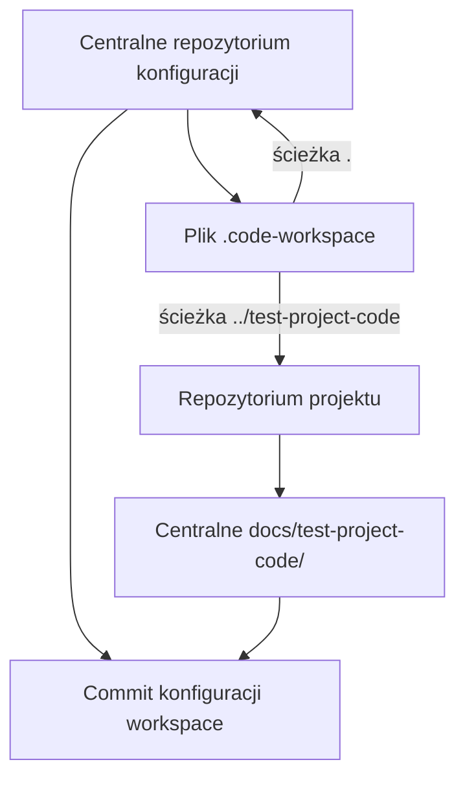

# Commit konfiguracji workspace

## Opis

Commit `docs(workspace): document project workspace and commit flow` opisuje konfigurację wielorepozytoryjnego workspace VS Code, centralne położenie dokumentacji projektu oraz rozdzielanie commitów między repozytoria. Powiązana dokumentacja: [[Workspace_Setup]] i [[20261021-1053_Logger]].

## Identyfikacja i zakres

- Repozytorium: `https://github.com/marekAren2/ai-multiagent-obsidian-template`
- Branch/commit: `10287590c31452625cb315c0975476d12c32aa80`
- Subject: `docs(workspace): document project workspace and commit flow`
- Zatwierdzone pliki: `.github/agents/docs.md`, `.github/copilot-instructions.md`, `ai-multiagent-obsidian-template.code-workspace`, `docs/Token_Metrics.md`, `docs/Workspace_Setup.md`, `docs/test-project-code/20261021-1053_Logger.md`.

Commit dokumentuje ścieżki workspace `.` i `../test-project-code` oraz centralną lokalizację dokumentacji projektu. Powyższa lista określa cały zakres commitu.

## Link i status

[Permalink do commitu](https://github.com/marekAren2/ai-multiagent-obsidian-template/commit/10287590c31452625cb315c0975476d12c32aa80). Link wskazuje commit na GitHubie; nie potwierdza pushowania. Commitu nie wypchnięto.

## Weryfikacja

`git diff --check` zakończył się powodzeniem, podobnie jak parsowanie JSON pliku workspace.

## Diagram przepływu

