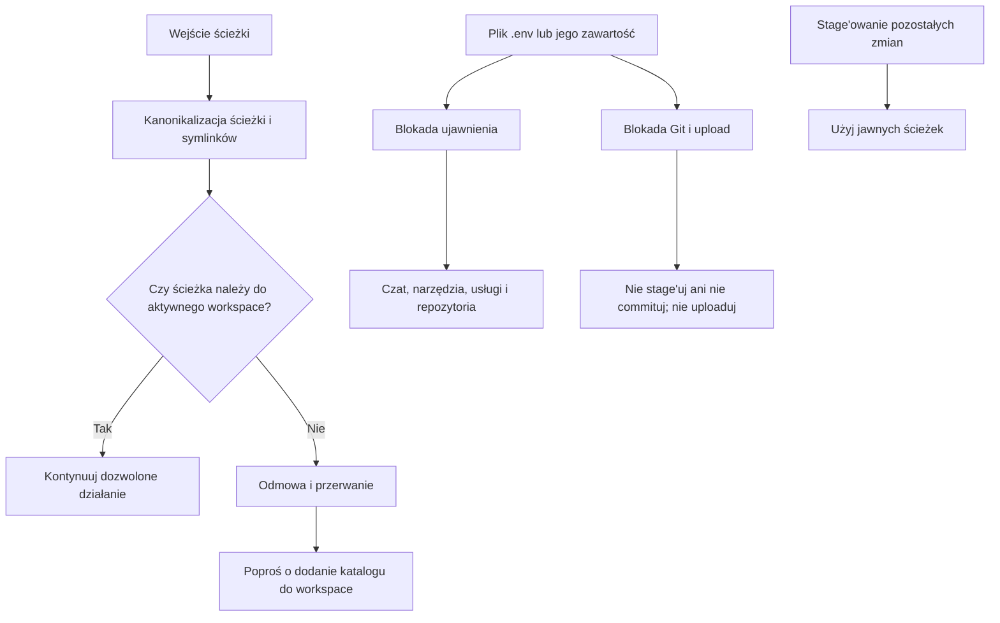

# Polityka granicy workspace i ochrony `.env`

Zasady opisane w [[Workspace_Setup]] uzupełniają praktyki z [[Lessons_Learned]] i pomagają zapobiegać problemom odnotowywanym w [[Bugs_Log]].

## Granica workspace

Działaj wyłącznie w folderach wymienionych w aktywnym pliku `.code-workspace`. Ścieżki względne rozwiązuj względem tego pliku; przed działaniem uwzględnij kanonikalizację ścieżki i symlinki. Jeśli ścieżka kanoniczna znajduje się poza folderami workspace, zatrzymaj działanie i poproś użytkownika o dodanie katalogu do workspace.

## Ochrona `.env`

Pliku `.env` ani jego zawartości nigdy nie wysyłaj, nie załączaj, nie wklejaj ani nie przekazuj do czatu, narzędzi, usług lub repozytoriów. Nie wyświetlaj ich w logach, terminalu, diffach ani raportach. Nie stage'uj, nie commituj ani nie uploaduj `.env`; przy stage'owaniu używaj jawnych ścieżek zamiast poleceń zbiorczych.

## Diagram

## Commit i link

- Subject: `sec: enforce workspace and env protections`
- Pełny hash: `d5aaa93f2d445fd9ee71ea2a19f9b9b4406718ae`
- Centralne repozytorium: https://github.com/marekAren2/ai-multiagent-obsidian-template
- Permalink: https://github.com/marekAren2/ai-multiagent-obsidian-template/commit/d5aaa93f2d445fd9ee71ea2a19f9b9b4406718ae

Commit jest lokalny i nie został jeszcze wypchnięty (push).
