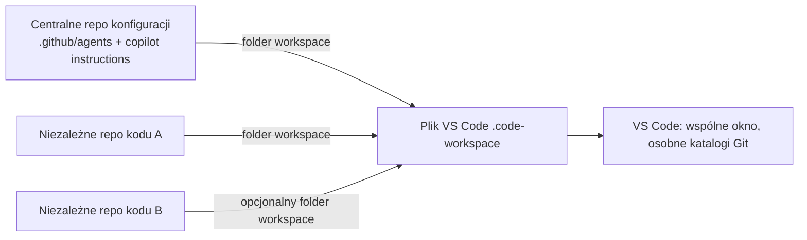

# Konfiguracja Workspace Multi-Repo

Tagi: #vscode #multi-repo #automatyzacja

## Architektura

Konfiguracja agentów (`.github/agents/` i `.github/copilot-instructions.md`) należy do centralnego repozytorium konfiguracyjnego. Repozytoria kodu pozostają odrębne i niezależne. Plik VS Code `.code-workspace` łączy centralną konfigurację oraz jedno lub więcej repozytoriów kodu jako foldery workspace; nie scala repozytoriów Git.

Powiązane notatki: [[Lessons_Learned]], [[Bugs_Log]], [[Token_Metrics]] oraz [[README]].



## Bieżący workspace w Codespace

Plik `ai-multiagent-obsidian-template.code-workspace` zawiera dwa foldery liczone względem katalogu, w którym leży:

| Folder workspace | Ścieżka względna | Katalog kanoniczny | Zawartość |
| :--- | :--- | :--- | :--- |
| AI Agents & Obsidian Config (Global) | `.` | `/workspaces/ai-multiagent-obsidian-template` | Instrukcje agentów i centralna dokumentacja |
| Kod Źródłowy (test-project-code) | `../test-project-code` | `/workspaces/test-project-code` | Kod projektu; katalog nie jest obecnie repozytorium Git |

Ścieżki `.` i `../test-project-code` wskazują odrębne katalogi: centralną konfigurację w `/workspaces/ai-multiagent-obsidian-template` oraz projekt w `/workspaces/test-project-code`. Sprawdzenie potwierdziło, że katalog projektu nie jest repozytorium Git. Dokumentację projektu zapisuj centralnie w `docs/test-project-code/`; nie dodawaj jej do katalogu projektu. Globalne rejestry pozostają bezpośrednio w `docs/`.

Po zainicjowaniu repozytorium Git w katalogu projektu, używając `init-ai.sh` dla tego układu, podaj repozytorium konfiguracji jako `--config-dir .` i projekt jako `--repo ../test-project-code`. Jeśli skrypt aktualizuje istniejący plik workspace, wymagane jest jawne `--update-workspace`.

### Rozdzielanie commitów

- Zmiany konfiguracji i workspace commituj wyłącznie w centralnym repozytorium `/workspaces/ai-multiagent-obsidian-template`.
- Kod loggera commituj w repozytorium projektu `/workspaces/test-project-code` dopiero po `git init`. Repozytorium nie ma remote, więc commit pozostaje lokalny i nie wykonuj push.
- Każdy z tych funkcjonalnych commitów dokumentuj w osobnym, nowym pliku timestampowanym: dokument commitu konfiguracji w głównym `docs/`, a dokument commitu projektu w `docs/test-project-code/`. Podaj hash oraz GitHub permalink, jeśli repo ma remote; bez remote podaj pełny hash i wynik `git show <hash>`.
- Docs-only commit, który ewidencjonuje hashe poprzednich commitów, nie wymaga własnego dokumentu: samodokumentowanie go tworzyłoby nieskończony łańcuch dokumentów.

## Wymagania

- Bash 5.2+, Git, `jq` oraz standardowe narzędzia systemowe (`mktemp`, `realpath`, `mv`, `rm`).
- Dostęp sieciowy HTTPS, jeżeli centralne repo ma być klonowane lub aktualizowane.
- Każde `--repo` musi wskazywać istniejący katalog będący repozytorium Git.
- Plik workspace przechowuje JSON w formacie VS Code: obiekt z tablicą `folders` oraz opcjonalnymi ustawieniami.

Skrypt nie pobiera konfiguracji automatycznie. Domyślne repo konfiguracyjne to `${XDG_CONFIG_HOME:-$HOME/.config}/ai-multiagent-obsidian-template`. Jeśli nie istnieje, należy podać HTTPS przez `--config-url`.

## Użycie

Zapisz poniższy blok jako `init-ai.sh` i uruchom `bash init-ai.sh ...`. Sam skrypt celowo nie jest dołączany ani wykonywany przez tę dokumentację.

### Przykłady

Utworzenie workspace dla repozytorium kodu i sklonowanie centralnej konfiguracji:

```bash
bash init-ai.sh --config-url https://github.com/example/ai-multiagent-obsidian-template.git --repo ../moja-aplikacja
```

Dopisanie dwóch repozytoriów do istniejącego pliku workspace:

```bash
bash init-ai.sh --repo ../api --repo ../web --workspace ./produkt.code-workspace --update-workspace
```

Sprawdzenie planu bez klonowania i zapisu:

```bash
bash init-ai.sh --repo ../moja-aplikacja --config-url https://github.com/example/ai-multiagent-obsidian-template.git --dry-run
```

Aktualizacja istniejącego repo konfiguracji wymaga również czystego repo i fast-forward:

```bash
bash init-ai.sh --repo ../moja-aplikacja --config-url https://github.com/example/ai-multiagent-obsidian-template.git --config-ref main --update-config --update-workspace
```

### Skutki uboczne i ograniczenia

- Pierwsze klonowanie tworzy centralne repozytorium w `--config-dir`; istniejący cel nigdy nie jest nadpisywany. Klonowanie odbywa się do tymczasowego katalogu obok celu, a potem repo jest przenoszone na miejsce. Brakujące katalogi nadrzędne ścieżki konfiguracji również mogą zostać utworzone.
- `--update-config` jest wymagane do aktualizacji. Repo musi być czyste, również bez nieśledzonych plików, mieć HTTPS `origin`, a jeśli podano `--config-url`, URL musi być zgodny z `origin`. Repo z lokalnie skonfigurowanymi filtrami Git `smudge` lub `process` jest odrzucane, aby checkout nie uruchomił poleceń filtra. Skrypt stosuje wyłącznie fast-forward; nie resetuje ani nie nadpisuje lokalnej historii lub zmian. Fetch może zaktualizować referencje zdalne, nawet gdy późniejsza kontrola fast-forward przerwie aktualizację.
- `--update-workspace` jest wymagane dla istniejącego pliku. `jq` parsuje i waliduje JSON, zachowuje ustawienia i foldery, a zapis odbywa się przez plik tymczasowy i atomowe `mv`. Docelowy symlink jest odrzucany.
- Ścieżki folderów wewnątrz katalogu workspace są względne względem pliku `.code-workspace`; ścieżki spoza niego pozostają absolutne. Duplikaty kanonicznych ścieżek i powtórzone nazwy w istniejącym pliku są odrzucane przed operacjami Git i zapisem. Kolizje nazw nowych folderów są rozwiązywane przez dodanie ścieżki do nazwy.
- `--dry-run` nie klonuje, nie pobiera zmian i nie zapisuje plików, więc nie potwierdza dostępności URL ani możliwości fast-forward. Skrypt wymaga katalogów głównych repozytoriów Git, nie inicjalizuje submodułów i nie zmienia konfiguracji globalnej VS Code. Nie uruchamia pobranych skryptów; podczas aktualizacji odrzuca lokalne filtry Git `smudge` i `process`, które mogłyby uruchamiać polecenia przy checkout.
- Jeśli klonowanie się powiedzie, a późniejszy zapis workspace nie powiedzie, sklonowane repo pozostaje na dysku. Inne typowe błędy to brak narzędzi, niezgodny URL, brudne repo, konflikt fast-forward, błędny JSON, symlink celu i duplikaty.

```bash init-ai.sh
#!/usr/bin/env bash
set -euo pipefail

if ((BASH_VERSINFO[0] < 5 || (BASH_VERSINFO[0] == 5 && BASH_VERSINFO[1] < 2))); then
  printf 'Błąd: wymagany jest Bash 5.2 lub nowszy\n' >&2
  exit 1
fi

usage() {
  cat <<'USAGE'
Użycie:
  bash init-ai.sh --repo DIR [--repo DIR ...] [opcje]

Wymagane:
  --repo DIR              Istniejące repozytorium kodu (można powtarzać)

Opcje:
  --config-dir DIR        Ścieżka centralnego repo; domyślnie
                          ${XDG_CONFIG_HOME:-$HOME/.config}/ai-multiagent-obsidian-template
  --config-url URL        HTTPS URL centralnego repo (klon tylko do nieistniejącego celu)
  --config-ref REF        Ref przekazywany do git clone --branch
  --workspace FILE        Plik workspace; domyślnie
                          <basename-pierwszego-repo>.code-workspace w bieżącym katalogu
  --update-config         Jawnie zezwól na fast-forward istniejącego czystego repo config
  --update-workspace      Jawnie zezwól na dopisanie brakujących folderów do istniejącego JSON
  --dry-run               Waliduj i pokaż zamiar; nie klonuj ani nie zapisuj plików
  --help                  Pokaż tę pomoc
USAGE
}

die() {
  printf 'Błąd: %s\n' "$*" >&2
  exit 1
}

need_value() {
  (($# >= 2)) || die "Brak wartości dla $1"
  [[ -n $2 ]] || die "Brak wartości dla $1"
}

declare -a repos=()
config_dir="${XDG_CONFIG_HOME:-$HOME/.config}/ai-multiagent-obsidian-template"
config_url=''
config_ref=''
workspace=''
update_config=0
update_workspace=0
dry_run=0

while (($#)); do
  case "$1" in
    --repo)
      need_value "$@"
      repos+=("$2")
      shift 2
      ;;
    --config-dir)
      need_value "$@"
      config_dir=$2
      shift 2
      ;;
    --config-url)
      need_value "$@"
      config_url=$2
      shift 2
      ;;
    --config-ref)
      need_value "$@"
      config_ref=$2
      shift 2
      ;;
    --workspace)
      need_value "$@"
      workspace=$2
      shift 2
      ;;
    --update-config)
      update_config=1
      shift
      ;;
    --update-workspace)
      update_workspace=1
      shift
      ;;
    --dry-run)
      dry_run=1
      shift
      ;;
    --help|-h)
      usage
      exit 0
      ;;
    --*)
      die "Nieznana opcja: $1 (użyj --help)"
      ;;
    *)
      die "Nieoczekiwany argument: $1 (użyj --help)"
      ;;
  esac
done

((${#repos[@]} > 0)) || die 'Podaj co najmniej jedno --repo'
command -v git >/dev/null 2>&1 || die 'Wymagany jest git'
command -v jq >/dev/null 2>&1 || die 'Wymagany jest jq'
command -v realpath >/dev/null 2>&1 || die 'Wymagane jest realpath'

if [[ -n $config_url ]]; then
  [[ $config_url =~ ^https://[^/[:space:]]+(/[^[:space:]]*)?$ ]] || die '--config-url musi być adresem HTTPS'
fi
if [[ -n $config_ref ]]; then
  git check-ref-format --branch "$config_ref" >/dev/null 2>&1 || die 'Niepoprawny --config-ref'
fi

declare -a canonical_repos=()
declare -A seen_repos=()
for repo in "${repos[@]}"; do
  [[ -d $repo ]] || die "Repozytorium nie jest istniejącym katalogiem: $repo"
  canonical=$(realpath -e -- "$repo") || die "Nie można rozwiązać ścieżki repozytorium: $repo"
  git -C "$canonical" rev-parse --show-toplevel >/dev/null 2>&1 || die "To nie jest repozytorium Git: $repo"
  root=$(realpath -e -- "$(git -C "$canonical" rev-parse --show-toplevel)")
  [[ $canonical == "$root" ]] || die "--repo musi wskazywać katalog główny repozytorium Git: $repo"
  [[ -z ${seen_repos[$canonical]+present} ]] || die "Powtórzone repozytorium po kanonikalizacji: $canonical"
  seen_repos[$canonical]=1
  canonical_repos+=("$canonical")
done

config_leaf=$(basename -- "$config_dir")
[[ $config_leaf != . && $config_leaf != / ]] || die 'Niepoprawna ścieżka --config-dir'
config_target=$(realpath -m -- "$config_dir") || die 'Nie można rozwiązać ścieżki --config-dir'
config_parent=$(dirname -- "$config_target")
config_exists=0
if [[ -e $config_target || -L $config_target ]]; then
  [[ -d $config_target && ! -L $config_target ]] || die 'Katalog konfiguracji musi być zwykłym katalogiem, nie symlinkiem'
  config_target=$(realpath -e -- "$config_target")
  config_exists=1
else
  [[ -n $config_url ]] || die "Brak katalogu konfiguracji. Podaj --config-url HTTPS albo utwórz $config_target"
fi

for repo in "${canonical_repos[@]}"; do
  [[ $repo != "$config_target" ]] || die 'Katalog konfiguracji nie może być jednocześnie repozytorium kodu'
done

if ((config_exists)); then
  git -C "$config_target" rev-parse --show-toplevel >/dev/null 2>&1 || die 'Istniejący --config-dir nie jest repozytorium Git'
  config_root=$(realpath -e -- "$(git -C "$config_target" rev-parse --show-toplevel)")
  [[ $config_root == "$config_target" ]] || die '--config-dir musi wskazywać katalog główny repozytorium Git'
  if [[ -n $config_url ]]; then
    current_origin=$(git -C "$config_target" remote get-url origin 2>/dev/null) || die 'Repo config nie ma remote origin'
    [[ $current_origin == "$config_url" ]] || die '--config-url nie zgadza się z origin istniejącego repo'
    [[ $current_origin =~ ^https://[^/[:space:]]+(/[^[:space:]]*)?$ ]] || die 'Origin repo config nie jest adresem HTTPS'
  fi
  if ((update_config)); then
    [[ -z $(git -C "$config_target" status --porcelain --untracked-files=all) ]] || die 'Aktualizacja config wymaga czystego repo (łącznie z plikami nieśledzonymi)'
    origin=$(git -C "$config_target" remote get-url origin 2>/dev/null) || die 'Aktualizacja config wymaga remote origin'
    [[ $origin =~ ^https://[^/[:space:]]+(/[^[:space:]]*)?$ ]] || die 'Aktualizacja jest dozwolona wyłącznie dla origin HTTPS'
    if git -C "$config_target" config --local --get-regexp '^filter\..*\.(smudge|process)$' >/dev/null 2>&1; then
      die 'Aktualizacja config nie obsługuje lokalnych filtrów Git smudge/process; usuń je lub zaktualizuj repo ręcznie'
    fi
  fi
elif ((update_config)); then
  die '--update-config wymaga istniejącego repozytorium config'
fi

if [[ -z $workspace ]]; then
  first_name=$(basename -- "${canonical_repos[0]}")
  workspace="$PWD/$first_name.code-workspace"
elif [[ $workspace != /* ]]; then
  workspace="$PWD/$workspace"
fi
workspace_parent=$(dirname -- "$workspace")
workspace_leaf=$(basename -- "$workspace")
[[ $workspace_leaf != . && $workspace_leaf != / ]] || die 'Niepoprawna ścieżka --workspace'
[[ -d $workspace_parent ]] || die "Katalog pliku workspace nie istnieje: $workspace_parent"
workspace_parent=$(realpath -e -- "$workspace_parent")
workspace="$workspace_parent/$workspace_leaf"
[[ ! -L $workspace ]] || die 'Docelowy plik workspace nie może być symlinkiem'
workspace_exists=0
if [[ -e $workspace ]]; then
  [[ -f $workspace ]] || die 'Docelowy workspace musi być zwykłym plikiem'
  workspace_exists=1
  ((update_workspace)) || die 'Plik workspace już istnieje; podaj --update-workspace, aby dopisać foldery'
fi

declare -A existing_workspace_paths=()
declare -A existing_workspace_names=()
if ((workspace_exists)); then
  jq -e 'type == "object" and ((.folders // []) | type == "array") and all((.folders // [])[]; type == "object" and (.path | type == "string" and length > 0 and (contains("\n") | not)) and (.name == null or (.name | type == "string" and length > 0 and (contains("\n") | not))))' "$workspace" >/dev/null || die 'Niepoprawny format workspace JSON lub folders'
  while IFS= read -r existing_folder; do
    if [[ $existing_folder == /* ]]; then
      existing_absolute=$existing_folder
    else
      existing_absolute="$workspace_parent/$existing_folder"
    fi
    existing_canonical=$(realpath -m -- "$existing_absolute") || die "Nie można rozwiązać folderu workspace: $existing_folder"
    [[ -z ${existing_workspace_paths[$existing_canonical]+present} ]] || die "Zduplikowane foldery workspace po kanonikalizacji: $existing_folder"
    existing_workspace_paths[$existing_canonical]=1
  done < <(jq -r '.folders[]?.path' "$workspace")
  while IFS= read -r existing_name; do
    [[ -z ${existing_workspace_names[$existing_name]+present} ]] || die "Powtórzona nazwa folderu workspace: $existing_name"
    existing_workspace_names[$existing_name]=1
  done < <(jq -r '.folders[]? | if (.name | type) == "string" then .name else (.path | split("/")[-1]) end' "$workspace")
fi

tmpdir=''
cleanup() {
  if [[ -n $tmpdir && -d $tmpdir ]]; then
    rm -rf -- "$tmpdir"
  fi
}
trap cleanup EXIT HUP INT TERM

export GIT_CONFIG_GLOBAL=/dev/null
export GIT_CONFIG_NOSYSTEM=1

if ((config_exists && update_config)); then
  if ((dry_run)); then
    printf 'DRY RUN: git fetch origin %s; sprawdzenie fast-forward dla %s\n' "${config_ref:-domyślnej gałęzi}" "$config_target"
  else
    if [[ -n $config_ref ]]; then
      git -C "$config_target" -c core.hooksPath=/dev/null fetch --no-recurse-submodules origin "$config_ref"
      target_ref="FETCH_HEAD"
    else
      git -C "$config_target" -c core.hooksPath=/dev/null fetch --no-recurse-submodules origin
      branch=$(git -C "$config_target" symbolic-ref --quiet --short HEAD) || die 'Detached HEAD: podaj --config-ref dla aktualizacji'
      target_ref="origin/$branch"
    fi
    git -C "$config_target" merge-base --is-ancestor HEAD "$target_ref" || die 'Aktualizacja nie jest fast-forward; repo pozostawiono bez zmian'
    git -C "$config_target" -c core.hooksPath=/dev/null merge --ff-only --no-edit "$target_ref"
  fi
fi

if ((!config_exists)); then
  if ((dry_run)); then
    printf 'DRY RUN: sklonowano by %s do %s\n' "$config_url" "$config_target"
  else
    [[ ! -e $config_target && ! -L $config_target ]] || die 'Cel klonowania pojawił się w trakcie działania; przerwano'
    mkdir -p -- "$config_parent"
    tmpdir=$(mktemp -d "${config_parent}/.${config_leaf}.clone.XXXXXXXX")
    clone_args=(--no-recurse-submodules)
    [[ -z $config_ref ]] || clone_args+=(--branch "$config_ref")
    git -c core.hooksPath=/dev/null clone "${clone_args[@]}" -- "$config_url" "$tmpdir/repo"
    [[ ! -e $config_target && ! -L $config_target ]] || die 'Cel klonowania pojawił się w trakcie działania; przerwano'
    mv -- "$tmpdir/repo" "$config_target"
  fi
fi

declare -a folder_paths=()
declare -A seen_paths=()
for folder in "$config_target" "${canonical_repos[@]}"; do
  [[ -z ${seen_paths[$folder]+present} ]] || die "Zduplikowany folder workspace po kanonikalizacji: $folder"
  seen_paths[$folder]=1
  [[ -n ${existing_workspace_paths[$folder]+present} ]] || folder_paths+=("$folder")
done

if ((dry_run)); then
  printf 'DRY RUN: workspace %s; foldery do sprawdzenia: %s\n' "$workspace" "${#folder_paths[@]}"
  [[ $workspace_exists == 0 ]] || printf 'DRY RUN: istniejące ustawienia i foldery pozostałyby zachowane\n'
  exit 0
fi

tmpdir=$(mktemp -d "${workspace_parent}/.${workspace_leaf}.tmp.XXXXXXXX")
tmpfile="$tmpdir/workspace.json"
if ((workspace_exists)); then
  cp -- "$workspace" "$tmpfile"
else
  printf '{"folders":[]}\n' >"$tmpfile"
fi

# Oblicz nazwy względem ścieżek kanonicznych; ścieżki nieosiągalne relatywnie pozostają absolutne.
declare -a entry_names=()
declare -a entry_paths=()
for folder in "${folder_paths[@]}"; do
  relative=$(realpath --relative-to="$workspace_parent" -- "$folder") || die "Nie można wyznaczyć ścieżki do $folder"
  if [[ $relative == .. || $relative == ../* ]]; then
    stored_path=$folder
  else
    stored_path=$relative
  fi
  entry_paths+=("$stored_path")
  entry_names+=("$(basename -- "$folder")")
done

declare -A reserved_names=()
for name in "${!existing_workspace_names[@]}"; do
  reserved_names[$name]=1
done
for ((i = 0; i < ${#entry_names[@]}; i++)); do
  base_name=${entry_names[$i]}
  candidate_name=$base_name
  suffix=2
  if [[ -n ${reserved_names[$candidate_name]+present} ]]; then
    candidate_name="$base_name (${entry_paths[$i]})"
    while [[ -n ${reserved_names[$candidate_name]+present} ]]; do
      candidate_name="$base_name (${entry_paths[$i]}) [$suffix]"
      ((suffix += 1))
    done
  fi
  entry_names[$i]=$candidate_name
  reserved_names[$candidate_name]=1
done

for ((i = 0; i < ${#entry_paths[@]}; i++)); do
  path_json=$(jq -cn --arg path "${entry_paths[$i]}" '$path')
  name_json=$(jq -cn --arg name "${entry_names[$i]}" '$name')
  if ! jq -e --argjson path "$path_json" 'any((.folders // [])[]; .path == $path)' "$tmpfile" >/dev/null; then
    jq --argjson path "$path_json" --argjson name "$name_json" '.folders = ((.folders // []) + [{"name": $name, "path": $path}])' "$tmpfile" >"$tmpfile.next"
    mv -- "$tmpfile.next" "$tmpfile"
  fi
done

jq -e 'type == "object" and (.folders | type == "array") and all(.folders[]; type == "object" and (.path | type == "string"))' "$tmpfile" >/dev/null || die 'Wygenerowany workspace nie przeszedł walidacji JSON'
if [[ -e $workspace || -L $workspace ]]; then
  [[ ! -L $workspace && -f $workspace ]] || die 'Cel workspace zmienił się na symlink lub inny typ pliku'
fi
mv -f -- "$tmpfile" "$workspace"
printf 'Gotowe: %s\n' "$workspace"