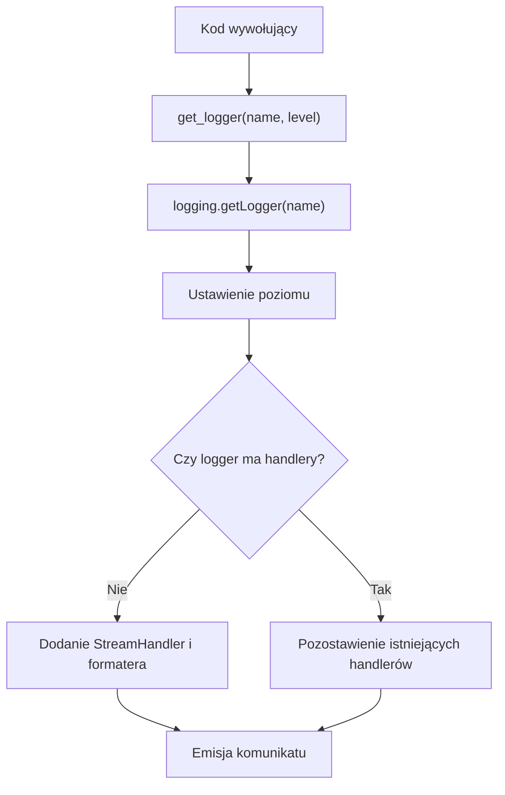

# Moduł logger

## Przeznaczenie

`/workspaces/test-project-code/logger.py` udostępnia `get_logger`, która pobiera nazwany logger ze standardowego rejestru Pythona, ustawia jego poziom i dodaje handler strumieniowy, jeśli logger nie ma jeszcze handlerów.

## API

```python
get_logger(name: str, level: int = logging.INFO) -> logging.Logger
```

- `name` identyfikuje logger pobierany przez `logging.getLogger(name)`.
- `level` jest ustawiany przy każdym wywołaniu przez `logger.setLevel(level)`; domyślnie jest to `logging.INFO`.
- Gdy logger nie ma handlerów, funkcja dodaje `logging.StreamHandler` z formatem `%(asctime)s - %(name)s - %(levelname)s - %(message)s`.
- Gdy logger ma już handler, funkcja nie dodaje kolejnego, ale nadal ustawia poziom.

## Użycie

```python
import logging

from logger import get_logger

logger = get_logger("worker", logging.DEBUG)
logger.debug("Zadanie rozpoczęte")
logger.info("Zadanie zakończone")
```

## Diagram przepływu



## Ograniczenia

- Moduł korzysta wyłącznie ze standardowej biblioteki `logging`.
- Nie konfiguruje handlera plikowego, rotacji logów ani ustawień zewnętrznych.
- Używa istniejącego loggera z rejestru Pythona; konfiguracja handlera jest wykonywana tylko wtedy, gdy logger nie ma handlerów.

Powiązane: [[Token_Metrics]] · [[Workspace_Setup]]